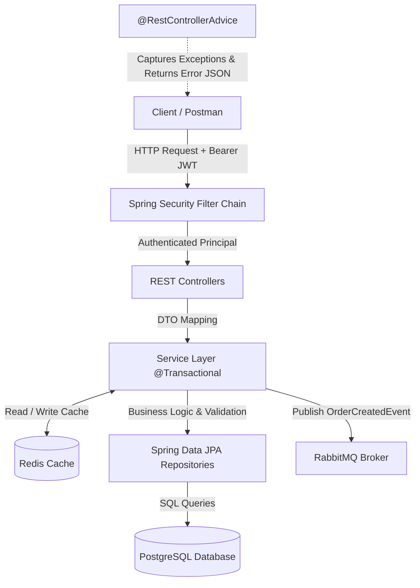
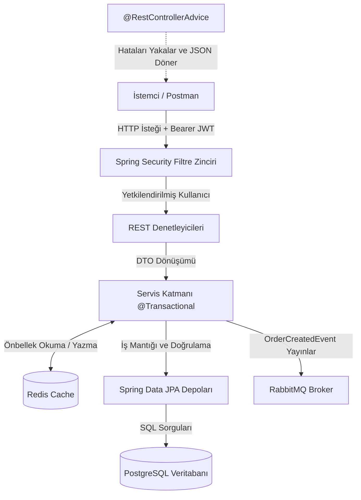

# 🛒 E-Commerce Core REST API

[](https://github.com/yusufkayiss/ecommerce-core-api/actions/workflows/maven.yml)

Production-ready, event-driven microservice core API built with Spring Boot, PostgreSQL, Redis, and RabbitMQ.

---

## 🌐 English

### 🚀 Overview
A robust, scalable, and enterprise-grade backend REST API designed for e-commerce applications. Built following clean architecture standards, DTO mappings, transactional service layers, Redis caching, and RabbitMQ event streaming for asynchronous notifications.

### 🛠 Tech Stack
- **Language**: Java 21
- **Framework**: Spring Boot 3.x
- **Messaging / Event Bus**: RabbitMQ (AMQP Event Producer)
- **Caching**: Redis
- **Security**: Spring Security & Stateless JWT Authentication (`@AuthenticationPrincipal`)
- **Persistence**: Spring Data JPA / Hibernate
- **Database**: PostgreSQL
- **Containerization**: Docker Compose
- **Documentation**: OpenAPI 3.0 / Swagger UI
- **Utilities**: Lombok

### 📐 System Architecture



### ✨ Architectural Highlights
- **Event-Driven Architecture**: Asynchronous event publishing to RabbitMQ (`OrderCreatedEvent`) decoupling core operations from notification mechanisms.
- **Distributed Caching**: Redis integration for high-performance data retrieval and session/cart management.
- **Stateless JWT Security**: End-to-end authentication with contextually bound user details via `@AuthenticationPrincipal`.
- **Decoupled DTO Architecture**: Custom response DTOs eliminating Hibernate proxy circular dependencies.
- **Transactional Order & Inventory Control**: Real-time stock verification, automated stock deduction, and atomic cart clearing upon order placement.
- **Global Exception Handling**: Centralized `@RestControllerAdvice` mapping exceptions to standardized `ErrorResponse` JSON payloads.

### 📖 API Documentation & Endpoints

Interactive Swagger UI is available when running the application locally:
- **Swagger UI**: `http://localhost:8080/swagger-ui.html`
- **OpenAPI Spec**: `http://localhost:8080/v3/api-docs`

#### 🔐 Authentication
- `POST /api/v1/auth/register` - Register a new user
- `POST /api/v1/auth/authenticate` - Login and retrieve JWT token

#### 🛒 Cart Management
- `GET /api/v1/cart` - Fetch user's active cart
- `POST /api/v1/cart/add` - Add item to cart
- `DELETE /api/v1/cart/items/{itemId}` - Remove item from cart

#### 📦 Order Management
- `POST /api/v1/orders` - Convert active cart to an order (Triggers RabbitMQ Event)
- `GET /api/v1/orders` - Fetch user order history

### 💻 Getting Started (Installation)

1. **Clone the repository:**
   ```bash
   git clone [https://github.com/yusufkayiss/ecommerce-core-api.git](https://github.com/yusufkayiss/ecommerce-core-api.git)
   cd ecommerce-core-api
   ```

2. **Run Full Stack via Docker Compose (Recommended)**
   ```bash
   docker compose up --build -d
   ```

---

## 📍 Türkçe

### 🚀 Genel Bakış
Spring Boot 3, Java 21, PostgreSQL, Redis ve RabbitMQ altyapısıyla geliştirilmiş; olay güdümlü (event-driven) mikroservis mimarisini destekleyen üretime hazır (production-ready) E-Ticaret Core REST API projesi.

### 🛠 Teknolojiler
- **Dil**: Java 21
- **Framework**: Spring Boot 3.x
- **Mesajlaşma / Event Bus**: RabbitMQ (AMQP Event Producer)
- **Önbellekleme**: Redis
- **Güvenlik**: Spring Security & Stateless JWT Kimlik Doğrulama (`@AuthenticationPrincipal`)
- **Veri Katmanı**: Spring Data JPA / Hibernate
- **Veritabanı**: PostgreSQL
- **Konteynerleştirme**: Docker Compose
- **Dokümantasyon**: OpenAPI 3.0 / Swagger UI
- **Araçlar**: Lombok

### 📐 Sistem Mimarisi



### ✨ Öne Çıkan Mimari Özellikler
- **Olay Güdümlü Mimari (Event-Driven)**: Sipariş oluştuğunda RabbitMQ üzerine `OrderCreatedEvent` fırlatarak bildirim servislerini ana sistemden bağımsız kılma.
- **Dağıtık Önbellekleme (Redis)**: Yüksek performanslı veri erişimi ve sepet/oturum yönetimi için Redis kullanımı.
- **Stateless JWT Güvenlik Mimarisi**: Oturum açmış kullanıcı bilgilerinin `@AuthenticationPrincipal` ile controller katmanına aktarılması.
- **Temiz DTO Katmanı**: Hibernate dairesel bağımlılık (circular reference) hatalarını engelleyen DTO yapısı.
- **Sipariş & Stok Yönetimi**: Sipariş verme sırasında anlık stok kontrolü, otomatik stok düşümü ve sepet sıfırlama işlemlerinin `@Transactional` bütünlükle yürütülmesi.
- **Merkezi Hata Yönetimi**: `@RestControllerAdvice` ile istisnaların yakalanıp standart `ErrorResponse` JSON çıktılarına dönüştürülmesi.

### 📖 API Dokümantasyonu & Endpoint'ler

- **Swagger UI**: `http://localhost:8080/swagger-ui.html`
- **OpenAPI Şeması**: `http://localhost:8080/v3/api-docs`

#### 🔐 Kimlik Doğrulama (Auth)
- `POST /api/v1/auth/register` - Yeni kullanıcı kaydı
- `POST /api/v1/auth/authenticate` - Giriş yapma ve JWT Token alımı

#### 🛒 Sepet Yönetimi (Cart)
- `GET /api/v1/cart` - Kullanıcı sepetini getirme
- `POST /api/v1/cart/add` - Sepete ürün ekleme
- `DELETE /api/v1/cart/items/{itemId}` - Sepetten ürün silme

#### 📦 Sipariş İşlemleri (Orders)
- `POST /api/v1/orders` - Sipariş oluşturma (RabbitMQ Olayı Tetikler)
- `GET /api/v1/orders` - Kullanıcı sipariş geçmişini listeleme

### 💻 Kurulum Adımları

1. **Repoyu Klonlayın:**
   ```bash
   git clone [https://github.com/yusufkayiss/ecommerce-core-api.git](https://github.com/yusufkayiss/ecommerce-core-api.git)
   cd ecommerce-core-api
   ```

2. **Docker Compose ile Tüm Yığını Çalıştırma:**
   ```bash
   docker compose up --build -d
   ```
