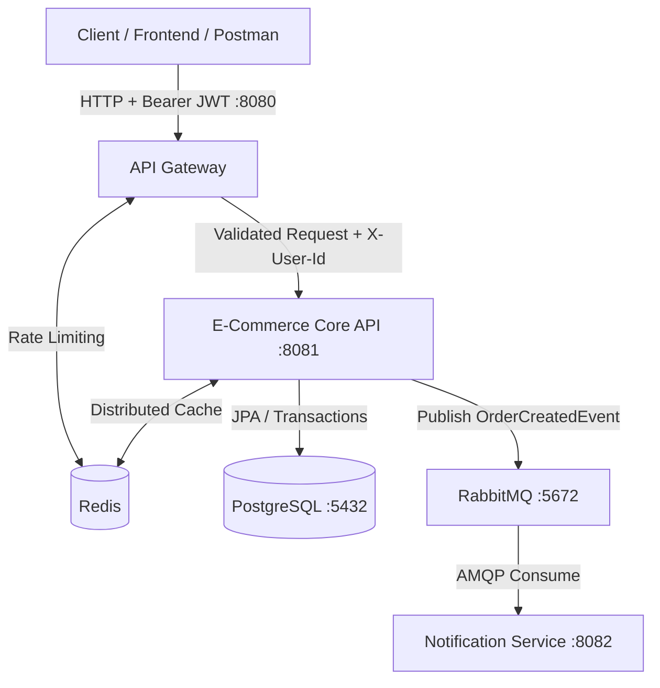
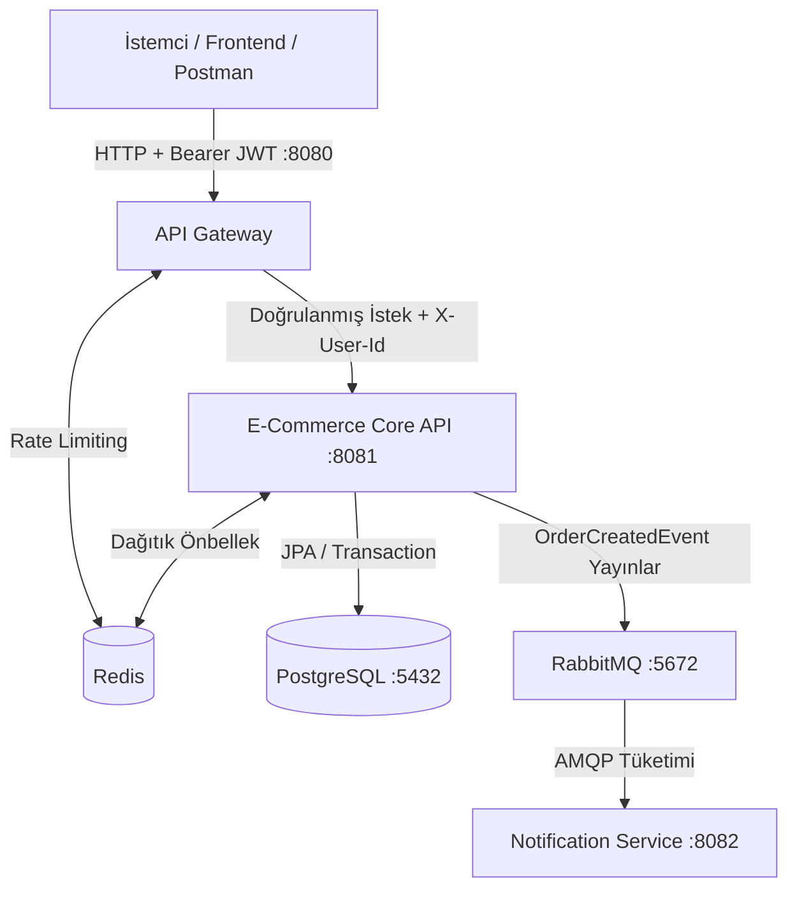

# 🛒 E-Commerce Microservices Platform & Core API

[](https://github.com/yusufkayiss/ecommerce-core-api/actions/workflows/maven.yml)

Production-ready, event-driven e-commerce backend platform built with **Spring Boot**, **Spring Cloud Gateway**, **PostgreSQL**, **Redis**, and **RabbitMQ**.

---

## 🌐 English

### 🚀 Overview
A distributed, scalable, and enterprise-grade backend architecture designed for modern e-commerce systems. This repository hosts the **Core Domain API** (Authentication, Catalog, Cart, Order & Inventory Management) alongside the root **Docker Compose** orchestration that connects the API Gateway and asynchronous Notification Service.

### 🧩 Microservices Ecosystem

| Service | Repository | Port | Stack | Responsibility |
| :--- | :--- | :---: | :--- | :--- |
| **API Gateway** | [`api-gateway`](https://github.com/yusufkayiss/api-gateway) | `8080` | Spring Cloud Gateway, Redis, Resilience4j | Central entry point, JWT validation, `X-User-Id` header injection, Rate Limiting & Circuit Breaker |
| **Core API** | [`ecommerce-core-api`](https://github.com/yusufkayiss/ecommerce-core-api) | `8081` | Java 17, Spring Boot 3.2, PostgreSQL, Redis, RabbitMQ | Auth/RBAC, Products, Categories, Cart, Transactional Orders & Event Publishing |
| **Notification Service** | [`notification-service`](https://github.com/yusufkayiss/notification-service) | `8082` | Java 21, Spring Boot 4.x, RabbitMQ | Asynchronous consumer listening to `OrderCreatedEvent` for customer notifications |

### 📐 System Architecture



### ✨ Architectural Highlights
- **Centralized Edge Security (API Gateway)**: Validates JWT tokens at the gateway level, strips spoofed `X-User-Id` headers, enforces Redis-backed rate limiting, and provides Resilience4j circuit breaking.
- **Event-Driven Order Pipeline**: Decouples order checkout from notifications by publishing `OrderCreatedEvent` messages to RabbitMQ (`~100ms` end-to-end delivery).
- **Transactional Inventory Control**: Atomic stock verification, stock deduction (`@Transactional`), and cart clearing upon order confirmation.
- **Role-Based Access Control (RBAC)**: Fine-grained authorization separating `USER` and `ADMIN` operations across catalog and order management.
- **Distributed Caching & Persistence**: PostgreSQL 16 for relational integrity and Redis 7 for caching and gateway throttling.
- **Global Exception Handling**: Centralized `@RestControllerAdvice` mapping domain and validation errors into standardized JSON responses.

### 📖 API Documentation & Endpoints

All client requests are routed through the **API Gateway** at `http://localhost:8080`.  
Direct Core API Swagger documentation is available at:
- **Swagger UI**: `http://localhost:8081/swagger-ui.html`
- **OpenAPI Spec**: `http://localhost:8081/v3/api-docs`
- **RabbitMQ Management UI**: `http://localhost:15672` (`guest` / `guest`)

#### 🔐 Authentication
- `POST /api/v1/auth/register` - Register a new user
- `POST /api/v1/auth/authenticate` - Authenticate and retrieve JWT token

#### 🏷️ Catalog (Categories & Products)
- `GET /api/v1/categories` - List all categories
- `POST /api/v1/categories` - Create a new category *(Admin)*
- `GET /api/v1/products` - List all products
- `GET /api/v1/products/{id}` - Get product details & stock
- `POST /api/v1/products` - Create a new product *(Admin)*

#### 🛒 Cart Management
- `GET /api/v1/cart` - Fetch authenticated user's active cart
- `POST /api/v1/cart/items` - Add item to cart
- `DELETE /api/v1/cart/items/{itemId}` - Remove item from cart

#### 📦 Order Management
- `POST /api/v1/orders` - Convert active cart into an order *(Triggers RabbitMQ Event)*
- `GET /api/v1/orders` - Fetch user order history
- `PATCH /api/v1/orders/{id}/status?status=COMPLETED` - Update order status *(Admin)*

### 💻 Getting Started (Docker Compose)

Because `compose.yaml` builds all three microservices together, clone the repositories into the same parent directory:

1. **Clone all microservice repositories:**
   ```bash
   mkdir ecommerce-platform && cd ecommerce-platform
   git clone [https://github.com/yusufkayiss/api-gateway.git](https://github.com/yusufkayiss/api-gateway.git)
   git clone [https://github.com/yusufkayiss/ecommerce-core-api.git](https://github.com/yusufkayiss/ecommerce-core-api.git)
   git clone [https://github.com/yusufkayiss/notification-service.git](https://github.com/yusufkayiss/notification-service.git)
   ```

2. **Start the entire stack via Docker Compose:**
   ```bash
   cd ecommerce-core-api
   docker compose up --build -d
   ```

3. **Verify running containers:**
   ```bash
   docker compose ps
   ```

---

## 📍 Türkçe

### 🚀 Genel Bakış
Modern e-ticaret sistemleri için tasarlanmış; dağıtık, ölçeklenebilir ve olay güdümlü (event-driven) mikroservis backend platformu. Bu depo, temel iş kurallarını barındıran **Core API** servisini ve tüm altyapıyı tek komutta ayağa kaldıran **Docker Compose** orkestrasyonunu içerir.

### 🧩 Mikroservis Ekosistemi

| Servis | GitHub Deposu | Port | Teknoloji Yığını | Sorumluluk |
| :--- | :--- | :---: | :--- | :--- |
| **API Gateway** | [`api-gateway`](https://github.com/yusufkayiss/api-gateway) | `8080` | Spring Cloud Gateway, Redis, Resilience4j | Tek giriş noktası, JWT doğrulama, `X-User-Id` başlık enjeksiyonu, Rate Limiting ve Circuit Breaker |
| **Core API** | [`ecommerce-core-api`](https://github.com/yusufkayiss/ecommerce-core-api) | `8081` | Java 17, Spring Boot 3.2, PostgreSQL, Redis, RabbitMQ | Kimlik doğrulama/RBAC, Ürün, Kategori, Sepet, Sipariş/Stok yönetimi ve Event yayını |
| **Notification Service** | [`notification-service`](https://github.com/yusufkayiss/notification-service) | `8082` | Java 21, Spring Boot 4.x, RabbitMQ | RabbitMQ üzerinden `OrderCreatedEvent` mesajlarını dinleyip asenkron bildirim işleme |

### 📐 Sistem Mimarisi



### ✨ Öne Çıkan Mimari Özellikler
- **Merkezi Gateway Güvenliği**: JWT doğrulamasını ağ geçidi katmanında yapar, sahte `X-User-Id` başlıklarını temizler, Redis tabanlı hız sınırlama (Rate Limiting) ve Resilience4j Circuit Breaker uygular.
- **Olay Güdümlü Sipariş Akışı (Event-Driven)**: Sipariş oluşturulduğunda RabbitMQ üzerine `OrderCreatedEvent` fırlatarak bildirim süreçlerini ana sistemden izole eder (`~100ms` uçtan uca iletim).
- **Transaction Bütünlüğünde Stok Yönetimi**: Sipariş onayı sırasında stok kontrolü, otomatik stok düşümü ve sepet temizleme işlemlerini `@Transactional` bütünlükle gerçekleştirir.
- **Rol Tabanlı Yetkilendirme (RBAC)**: Katalog ve sipariş yönetimi uçlarında `USER` ve `ADMIN` yetkilerini birbirinden ayırır.
- **Merkezi Hata Yönetimi**: `@RestControllerAdvice` ile tüm istisnaları standartlaştırılmış JSON hata yanıtlarına dönüştürür.

### 📖 API Dokümantasyonu & Endpoint'ler

Tüm istemci istekleri **API Gateway** (`http://localhost:8080`) üzerinden yönlendirilir.  
Doğrudan Core API dokümantasyonu ve yönetim panelleri:
- **Swagger UI**: `http://localhost:8081/swagger-ui.html`
- **OpenAPI Şeması**: `http://localhost:8081/v3/api-docs`
- **RabbitMQ Yönetim Paneli**: `http://localhost:15672` (`guest` / `guest`)

#### 🔐 Kimlik Doğrulama (Auth)
- `POST /api/v1/auth/register` - Yeni kullanıcı kaydı
- `POST /api/v1/auth/authenticate` - Giriş yapma ve JWT Token alımı

#### 🏷️ Katalog (Kategori & Ürün)
- `GET /api/v1/categories` - Kategorileri listeleme
- `POST /api/v1/categories` - Yeni kategori oluşturma *(Admin)*
- `GET /api/v1/products` - Ürünleri listeleme
- `GET /api/v1/products/{id}` - Ürün detayı ve güncel stok bilgisi
- `POST /api/v1/products` - Yeni ürün oluşturma *(Admin)*

#### 🛒 Sepet Yönetimi (Cart)
- `GET /api/v1/cart` - Aktif kullanıcı sepetini getirme
- `POST /api/v1/cart/items` - Sepete ürün ekleme
- `DELETE /api/v1/cart/items/{itemId}` - Sepetten ürün çıkarma

#### 📦 Sipariş İşlemleri (Orders)
- `POST /api/v1/orders` - Aktif sepeti siparişe dönüştürme *(RabbitMQ Olayı Tetikler)*
- `GET /api/v1/orders` - Kullanıcı sipariş geçmişini listeleme
- `PATCH /api/v1/orders/{id}/status?status=COMPLETED` - Sipariş durumunu güncelleme *(Admin)*

### 💻 Kurulum Adımları (Docker Compose)

`compose.yaml` dosyası üç mikroservisi birlikte derlediği için repoları aynı ana klasör altına klonlayın:

1. **Tüm mikroservis depolarını klonlayın:**
   ```bash
   mkdir ecommerce-platform && cd ecommerce-platform
   git clone [https://github.com/yusufkayiss/api-gateway.git](https://github.com/yusufkayiss/api-gateway.git)
   git clone [https://github.com/yusufkayiss/ecommerce-core-api.git](https://github.com/yusufkayiss/ecommerce-core-api.git)
   git clone [https://github.com/yusufkayiss/notification-service.git](https://github.com/yusufkayiss/notification-service.git)
   ```

2. **Tüm sistemi Docker Compose ile ayağa kaldırın:**
   ```bash
   cd ecommerce-core-api
   docker compose up --build -d
   ```

3. **Çalışan konteynerleri doğrulayın:**
   ```bash
   docker compose ps
   ```
